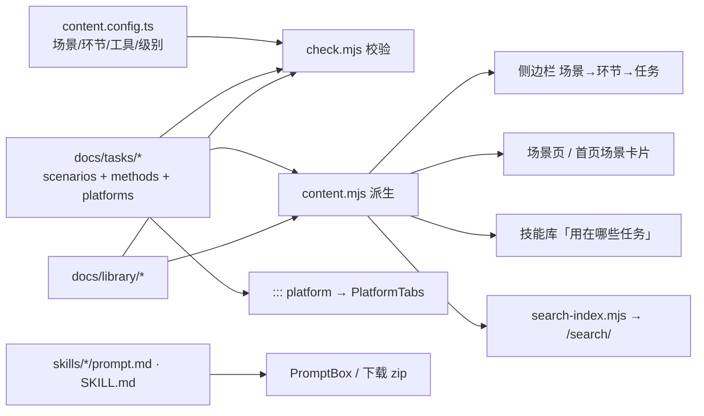

# AI 提效指南（WorkSmarterWithAI）· 设计文档

> 版本 v0.3 · 2026-11-16 · 状态：已确认方向，待实施（待定事项见第 12 节）
>
> 项目名：AI 提效指南 · 仓库名 `WorkSmarterWithAI` · 域名待定。

## 0. v0.3 改了什么

v0.2 按「技术」组织全站：导航是 Skill（技能）/ 工作流 / AI 应用 / 按平台。读者却是带着「我要做一件事」来的，他不会先想「我要找个 Skill」，而是想「我要写周报 / 做竞品分析 / 看懂体检报告，AI 能怎么帮我」。

v0.3 改成**按场景组织**：

1. **主入口按场景**：工作（职场通用 / 按岗位 / 按项目）和生活。左侧菜单为「场景 → 环节 → 任务」（第 3 节）。
2. **一篇文章 = 一个具体任务**，例如「用 AI 做竞品分析」。文章里给出几种做法：用 Skill（技能）、用工作流、直接用某个 AI 应用。这三类从导航降为文章里「做法」的标签（第 2 节）。
3. **工具不上导航**：豆包工作、WorkBuddy、知办、Codex 等工具，只出现在文章里的标签页中，读者切到自己用的那个即可（第 4.4 节）。
4. **新增「技能库」**：全站用到的 Skill、工作流、AI 应用都列在这里，每个条目只有一份，并标明「用在哪些任务」（第 3.5 节）。
5. **搜索和「全部教程」合并**：一个搜索页，边搜边筛（第 3.6 节）。
6. **面向所有人，包括长辈和非互联网行业的人**：新增「生活」板块；新手入门从零讲起；每篇任务都有「检查一下」（第 1 节的调研结论）。

### 相对当前实现（commit `04e2313`，v0.2）的取舍

| 保留 | 去掉或替换 | 修正 |
|---|---|---|
| 入门 / 进阶 / 高级，按工具分别标注 | 导航里的 Skill / 工作流 / AI 应用 / 按平台 / 按行业 / 全部教程 | v0.2 把「豆包普通聊天」的实测记在了「豆包工作」名下。v0.3 拆成两个工具：`doubao`（豆包，App / 网页对话）和 `doubao-work`（豆包工作） |
| `::: platform` 标签页、偏好记忆、`?platform=` 覆盖、全部内容输出进 HTML | 侧边栏「类型 → 级别 → 文章」→ 改为「场景 → 环节 → 任务」 | |
| 测试记录、`PlatformTestTable`、按工具过期、不造假规则 | 首页「你现在是？」和 `PlatformPicker` → 改为「你想用 AI 做什么？」 | |
| `Term` 和术语表、`LevelBadge`、`PlatformBadges`、折叠块 | `/catalog/` → `/search/`；`/industries/` → `/scenarios/` | |
| `PromptBox`、`ArticleSummary`、第一课卡片、大白话 | `/skills/` `/workflows/` `/apps/` `/platforms/` `/tools/` 列表页 → `/library/` | |
| 只展示有内容的分类 | frontmatter 的 `type`、`industry` → `methods`、`scenarios` | |

`design/mockups/v0.2-design.png` 作废，不再作为实现参考。

---

## 1. 定位

**一句话**：一本开源、持续更新的手册，从工作和生活里的具体事情出发，讲清楚 AI 能怎么帮你做、用什么做、在你手里的工具上怎么做、做完怎么检查。

### 1.1 调研：普通人用 AI 的真实情况

| 发现 | 对手册的影响 |
|---|---|
| 截至 2025 年 6 月，国内生成式 AI 用户 5.15 亿，普及率 36.5%，**约三分之二的人还没用过**；40 岁以上用户只占 25.4% | 新手入门从零讲起：装哪个 App、怎么用语音、第一句话说什么 |
| 用户里 **80.9% 只拿 AI 来回答问题**，生成会议纪要和 PPT 的占 29.7%，写代码的只占 10.3% | 手册的核心价值是带人从「问问题」走到「让 AI 帮我干活」，所以按具体的事来讲 |
| 使用率最高的是豆包（72.2%）和 DeepSeek（62.0%） | 生活类任务的标签页优先放豆包、DeepSeek 这类手机 App，不一定是办公工具 |
| 老人不用 AI，主要卡在**没人教、不好用**：老人提的建议里，超过 70% 要的是更易用的产品和更多培训，担心安全的只占 4%。老人最常用 AI 问健康问题、用语音代替打字、查日常信息 | 设「生活」板块；生活类文章用手机截图、讲语音操作 |
| 职场中超过一半的人用 AI 写文档，但只有 47% 受过系统培训；**66% 不核对 AI 的结果，56% 因此在工作中出过错** | 每篇任务必须有「检查一下」；新手入门里单独讲「AI 会出错」 |
| 微软官方的 Copilot 场景库按部门、岗位、行业组织，每个场景写清能做成什么、用什么工具、给出示例提示词 | 按场景组织的做法已有成熟先例 |

来源：[新华网：生成式 AI 用户规模达 5.15 亿](http://www.news.cn/tech/20251020/c7c8f6c858c249e2bb69515f40eeab8b/c.html) · [CNNIC《生成式人工智能应用发展报告（2025）》](https://pdf.dfcfw.com/pdf/H301_AP202510241768289458_1.pdf) · [阿里巴巴《2025「银发+AI」应用趋势报告》](https://client.sina.com.cn/news/2025-10-28/doc-infvmezv1409332.shtml) · [人民论坛网：数字鸿沟下的老年群体](https://www.rmlt.com.cn/2025/0418/728023.shtml) · [前程无忧《2025 职场 AI 应用趋势报告》](https://cn.chinadaily.com.cn/a/202503/04/WS67c6a0b0a310510f19ee9a85.html) · [毕马威全球 AI 信任调查（南方都市报）](https://epaper.oeeee.com/epaper/A/html/2025-05/13/content_4841.htm) · [Microsoft Copilot Scenario Library](https://aihub.msstate.edu/app/resources/microsoft-copilot-scenario-library)

### 1.2 读者和他们的入口

| 读者 | 他怎么找 | 在文章里得到什么 |
|---|---|---|
| 第一次用 AI 的人（含长辈） | 新手入门，或首页的常见任务 | 大白话步骤 + 截图，跟着做一次 |
| 有具体工作要做的人 | 工作 → 自己的岗位 / 项目 → 环节 → 任务 | 推荐做法 + 自己工具的标签页 |
| 已经在用 AI 的人 | 搜索、技能库 | 其他做法、「进阶玩法」折叠块 |
| AI 从业者 / 开发者 | 技能库、项目类场景（如 AI 应用开发）、Codex 标签 | 「给懂行的人」折叠块、测试记录、技能包源文件 |

### 1.3 原则

1. **从事情出发**：先说能帮你做成什么，再说用什么工具。
2. **实测为准**：每个工具单独写实测日期和版本，没测过的不写成测过。
3. **做完要检查**：每篇都告诉读者哪些结果必须人工核对。
4. **语言浅、内容可深**：全站短句和大白话；深的内容放在折叠块里，术语首次出现必须解释。
5. **全程开源**：正文、配置、源码都在 GitHub，接受纠错和实测投稿。

---

## 2. 内容模型

### 2.1 四种页面

| 页面 | 是什么 | 例子 |
|---|---|---|
| **任务文章** | 一件具体的事，怎么用 AI 做完。全站的主体 | 用 AI 做竞品分析；把会议记录变成待办表 |
| **新手课** | 从零开始的基础课，按顺序学 | 第一次用 AI：发出第一条消息 |
| **技能库条目** | 一个可复用的工具：Skill、工作流或 AI 应用 | 技能「先问清楚再动手」；AI 应用「豆包工作」 |
| **评测** | 同类工具横向对比或深度测评 | 四个办公智能体导入技能横评 |

### 2.2 场景、环节、任务

- **场景**：一个读者能认出自己的领域，分两大组：
  - **工作**：职场通用 / 按岗位（行政人事、新媒体运营、电商运营、财务、教师……）/ 按项目（AI 应用开发、做一个自媒体账号……）
  - **生活**：学习辅导、健康、出行、长辈用 AI……
- **环节**：场景里按先后排的步骤，例如 AI 应用开发分为「想法与需求 → 产品设计 → 开发 → 上线 → 运营」。生活类场景可以没有环节，直接列任务。
- **任务**：环节里的一件具体的事。**一篇任务文章可以出现在多个场景**。例如「整理用户反馈」既属于电商运营，也属于 AI 应用开发的运营环节。

场景和环节只在 `content.config.ts` 里定义。初始清单见第 3.3 节。

### 2.3 做法：Skill（技能）/ 工作流 / AI 应用

每篇任务文章给出一种或几种做法，每种做法标上类型：

| 做法类型 | 中文名 | 是什么 | 例子 |
|---|---|---|---|
| `skill` | Skill（技能） | 可复制、可导入的能力包。细分 `format`：提示词 `prompt`、技能包 `skill`（带 `SKILL.md`）、MCP 连接 `mcp` | 复制一段提示词；导入「先问清楚」技能包 |
| `workflow` | 工作流 | 多个步骤串起来的流程，可以手动分步，也可以在平台上搭好自动跑 | 在飞书多维表格里每周自动汇总评论 |
| `app` | AI 应用 | 直接用某个软件的现成功能 | 用豆包的「AI 写作」；用秘塔做深度搜索 |

**规则**：
- 第一种做法是**推荐做法**，应该是最简单、级别最低的那个，带工具标签页。
- 其他做法写在「其他做法」小节，只写一段说明和链接，不带标签页。某种做法需要分工具详细讲时，就单独写成一篇任务文章。
- 每种做法引用技能库里的一个条目（`use`），技能库据此自动生成「用在哪些任务」。

### 2.4 级别：按「需要会什么」定义（同 v0.2）

| 级别 | 读者需要会什么 | 典型用时 | 徽章颜色 |
|---|---|---|---|
| **入门** | 打开网页或 App，点按钮、拖文件、复制粘贴、说话 | 10 分钟内 | 绿 |
| **进阶** | 改造、组合现成技能，配连接器，在平台上搭工作流，或在 Codex 里使用技能 | 30~60 分钟 | 蓝 |
| **高级** | 自己写 `SKILL.md`、加脚本、写 MCP、调用 API、发布 | 半天以上 | 紫 |

- 级别**按工具分别标注**：同一件事，在豆包工作里是入门，在 Codex 里可能是进阶。
- 文章级「最低级别」= 推荐做法各工具级别中最低的那个，用于侧边栏徽章和搜索筛选。

### 2.5 工具（标签页）

所有软件统一放在 `content.config.ts` 的 `apps` 里，取代 v0.2 的 `platforms` 和 `tools` 两个列表：

| 字段 | 说明 |
|---|---|
| `slug`、`name` | 例如 `doubao-work` / 豆包工作 |
| `category` | 对话助手 / 办公智能体 / 编程工具 / 搜索 / 自动化平台…… |
| `website`、`docs` | 官网、官方文档；不确定的留空 |
| `tab` | 能否作为文章里的工具标签页 |
| `skills` | 能否导入 `SKILL.md` 技能包 |
| `developer` | 是否标「开发者」 |
| `defaultLevel`、`order` | 默认级别、标签排序 |

初始工具：

| slug | 名称 | 类别 | 支持技能包 | 默认级别 | 备注 |
|---|---|---|---|---|---|
| `doubao` | 豆包 | 对话助手（App / 网页） | 否 | 入门 | 现有「会议待办」「第一条消息」的实测都在这里 |
| `doubao-work` | 豆包工作 | 办公智能体 | 是 | 入门 | 插件·技能·伙伴 → 技能 → 添加 → 上传技能 |
| `workbuddy` | WorkBuddy | 办公智能体 | 是 | 入门 | 添加技能 → 上传技能；也有技能市场 |
| `zhiban` | 知办 | 待确认 | 待确认 | 入门 | 官网和文档待确认 |
| `codex` | Codex | 编程工具 | 是 | 进阶 | 标「开发者」 |
| `deepseek` | DeepSeek | 对话助手 | 否 | 入门 | 有内容后再启用 |

**哪些任务必须有哪些标签**：

| 推荐做法 | 规则 |
|---|---|
| Skill · 技能包（`format: skill`） | **必须**包含所有 `skills: true` 的工具标签（豆包工作、WorkBuddy、知办、Codex）。不支持的标「暂不支持」并写原因 |
| Skill · 提示词（`format: prompt`） | 至少一个对话类工具（通常是豆包）的完整截图步骤；其余工具写一句「粘贴到对话框即可」，不强制标签 |
| 工作流 | 能在哪些平台搭就给哪些平台的标签 |
| AI 应用 | 讲的就是这个应用，一般不需要标签 |

frontmatter 的字段名沿用 v0.2 的 `platforms`，标签页、徽章、筛选等界面文案里一律叫「工具」。

---

## 3. 信息架构

### 3.1 顶部导航

```
新手入门 | 工作 ▾ | 生活 ▾ | 技能库 | 🔍 搜索 | 更多 ▾
```

- **工作 ▾**：下拉分三组（职场通用 / 按岗位 / 按项目），每组只列有内容的场景。底部一行「全部场景 →」。
- **生活 ▾**：只列有内容的场景；生活一篇内容都没有时，整个菜单不显示。
- **技能库**：链接到 `/library/`。
- **搜索**：导航上的搜索按钮进入 `/search/`（手机上是放大镜图标）。
- **更多 ▾**：最近更新 / 评测 / 术语表 / 评测规则 / 关于 / 参与贡献。

### 3.2 页面清单

| 页面 | 路径 | 说明 |
|---|---|---|
| 首页 | `/` | 见 3.7 |
| 新手入门 | `/start/`，课程在 `/start/<slug>/` | 按顺序的基础课 |
| 场景总览 | `/scenarios/` | 工作、生活两组场景卡片 |
| 场景页 | `/scenarios/<id>/` | 场景简介 → 按环节列任务（带级别徽章）→ 这个场景常用的技能 |
| 任务文章 | `/tasks/<slug>/` | URL 扁平，场景调整时 URL 不变 |
| 技能库 | `/library/` | 见 3.5 |
| 技能库条目 | `/library/skills/<id>/`、`/library/workflows/<id>/`、`/library/apps/<id>/` | 见 3.5 |
| 评测 | `/reviews/<slug>/` | 也在技能库对应条目里列出 |
| 搜索 | `/search/` | 见 3.6 |
| 术语表 | `/glossary/` | 保留 |
| 最近更新、关于、参与贡献、评测规则、下载 | 保留原路径 | |

### 3.3 场景初始清单

只有有内容的场景和环节才会出现在导航、侧边栏和场景总览里。

| 组 | 场景 id | 名称 | 环节 |
|---|---|---|---|
| 工作 · 职场通用 | `office` | 职场通用 | 写材料 · 开会 · 表格与数据 · 汇报与 PPT · 沟通与邮件 |
| 工作 · 按岗位 | `hr` | 行政人事 | 招聘 · 入职与培训 · 活动与会议 · 日常行政 |
| | `media` | 新媒体运营 | 选题 · 写稿 · 图片与视频 · 发布与复盘 |
| | `commerce` | 电商运营 | 选品与竞品 · 商品详情 · 客服 · 评论与复盘 |
| | `finance` | 财务 | 票据与报销 · 报表 · 分析 |
| | `teacher` | 教师 | 备课 · 出题 · 批改与反馈 |
| 工作 · 按项目 | `ai-app` | AI 应用开发 | 想法与需求 · 产品设计 · 开发 · 上线 · 运营 |
| 生活 | `study` | 学习辅导 | （不分环节） |
| | `health` | 健康 | （不分环节） |
| | `travel` | 出行 | （不分环节） |
| | `elders` | 长辈用 AI | （不分环节） |

以「AI 应用开发」为例，规划中的任务：

```
AI 应用开发
├─ 1. 想法与需求   需求调研 · 竞品分析 · 把用户访谈整理成需求 · 写 PRD
├─ 2. 产品设计     画原型 · 出 UI 设计稿
├─ 3. 开发         搭项目骨架 · 写代码和调试 · 写测试
├─ 4. 上线         部署上线 · 写使用说明
└─ 5. 运营         写推广文案 · 整理用户反馈
```

### 3.4 左侧边栏

- **任务、场景页**：一棵树「工作 / 生活 → 场景 → 环节 → 任务」。所有场景默认折叠，当前页面所在的场景自动展开。每个任务后面显示最低级别徽章。
- 同一篇任务属于多个场景时，在每个场景下都出现。
- 一个环节只有一篇时，不再单独套一层。
- **新手入门**：按课程顺序列出。
- **技能库**：Skill（技能）/ 工作流 / AI 应用 三组，只显示有条目的组。
- 侧边栏由脚本根据 frontmatter 和配置自动生成，`order` 控制排序。

### 3.5 技能库

全站用到的所有工具都在这里，每个只有一份。主要给想按工具找的人：已经在用 AI 的人和从业者。

- `/library/` 分三组：**Skill（技能）**、**工作流**、**AI 应用**。只显示有条目的组。
- 卡片：名称、一句话、类型和 format 标签、是否自研、各工具实测状态、「用在 N 个任务」。
- **条目页**：
  - Skill：是什么、下载 / 一键复制、`SKILL.md` 内容、各工具实测状态、**用在哪些任务**（自动生成）、测试记录、「给懂行的人」逐段解读。
  - 工作流：流程图、导出文件下载、需要哪些平台、用在哪些任务。
  - AI 应用：简介、怎么安装和注册、价格（写明截至日期）、**怎么导入技能**（支持技能包的工具）、用在哪些任务、相关评测。v0.2 的四个平台入门页内容都并入这里。
- AI 应用条目只为**确有内容的工具**生成。「知办」确认前不出现在技能库里，标签页里显示「即将补充」。

### 3.6 搜索（合并「全部教程」）

- 一个页面 `/search/`：顶部是搜索框，下面是筛选和结果。不输入关键词时，显示全部内容，作用等于原来的「全部教程」。
- **搜索范围**：任务文章、新手课、技能库条目、评测。索引包括标题、简介、标签、场景和环节名、小标题和正文。
- **筛选**：场景、级别、做法（Skill / 工作流 / AI 应用）、工具、只看已实测、只看自研。
- 只显示有内容的选项，每个选项后面显示篇数；工具和级别联动（选「豆包 + 入门」，只显示在豆包上是入门的）。
- 筛选状态和关键词写进 URL（如 `/search/?q=会议&tool=doubao&level=入门`），方便分享。
- 去掉 VitePress 自带的搜索弹窗，避免出现两种搜索。快捷键 ⌘K / Ctrl+K 跳转到 `/search/`，并聚焦搜索框。

### 3.7 首页

1. **你想用 AI 做什么？** 一个大搜索框（提交后进入 `/search/?q=`），下面一排常见任务按钮。按钮来自 `featured: true` 的任务，只显示已发布的任务。
2. **第一课卡片**：保留现有「把会议记录变成待办表」。
3. **三个入口**：
   - 第一次用 AI → 新手入门
   - 工作上用 → 场景卡片（只列有内容的）
   - 生活里用 → 场景卡片（有内容时才显示）
4. 一行小字：「已经会用了？去技能库 →」。
5. 去掉「你现在是？」和「你用哪个工具？」。工具偏好在读者第一次点标签页时记住。
6. 文案保留「新手跟着做就会，懂行的人也有干货」。

---

## 4. 文章规范

### 4.1 任务文章 frontmatter

```yaml
---
title: 把会议记录变成待办表          # 用「做成什么」命名，不用工具名开头
description: 复制几句会议记录，得到一张「谁做什么、什么时候做」的表。
kind: guide                          # guide | review | original
scenarios:                           # 第一个是主场景
  - { scenario: office, stage: meeting }
  - { scenario: hr, stage: events }
methods:                             # 第一个是推荐做法，对应下面的 platforms 标签页
  - { type: skill, use: meeting-to-todo }
  # 有其他做法时继续往下列，每项写 type、use、note（一句话）、level、status
featured: true                       # 是否在首页常见任务里出现
audience: 经常开会的人
time: 约 3 分钟（不含登录）
cost: 免费额度内
tags: [会议, 待办]
created: 2026-11-16
updated: 2026-11-16
sponsored: false
authors: [zbwork]

platforms:                           # 推荐做法在各工具上的级别和实测（同 v0.2）
  doubao:
    level: 入门
    status: active                   # active | unverified | planned | unsupported | outdated
    verified: 2026-11-16
    version: 豆包网页版，页面未显示模型版本
    prerequisites: 会复制、粘贴和点击按钮
---
```

新手课用同样的字段，`scenarios` 和 `methods` 可以为空，另加 `lesson: 1`（课程顺序）。

**派生规则**（脚本计算，同 v0.2）：文章级 `difficulty`、`status`、`verified` 由 `platforms` 派生；做法类型标签由 `methods` 派生。

**校验规则**（CI）：
- `scenarios` 的场景和环节必须在配置里存在；任务文章至少属于一个场景（评测除外）。
- `methods[].use` 必须指向存在的技能库条目；`type` 要和条目的类型一致。
- 推荐做法是技能包的任务，`platforms` 必须包含全部 `skills: true` 的工具。
- `platforms` 的 key 必须是 `tab: true` 的工具。
- `active` 的工具必须有 `verified` 和 `version`，对应标签里必须至少有一张该工具的真实截图。
- `planned`、`unsupported` 的工具不能写操作步骤；`unsupported` 必须写原因。
- 正文必须有「检查一下」小节（新手课、评测除外）。
- **发布标准**：推荐做法是技能包的任务，至少 1 个工具 `active` 才进默认列表，否则为草稿（只在 `/search/?draft=1` 可见）。其他任务允许 `unverified` 发布，但要醒目标「待实测」（沿用 AGENTS.md 规则）。
  - v0.2 要求至少 2 个 `active`。v0.3 以任务为主，在一个工具上实测通过的任务对读者已经有用，其他工具显示「待实测」即可。

### 4.2 技能库条目 frontmatter

```yaml
---
name: 先问清楚再动手
description: 装上后，AI 会先列出它需要知道的信息，确认后再写。
libraryType: skill            # skill | workflow | app
format: skill                 # 仅 skill：prompt | skill | mcp
original: true                # 是否自研
source: skills/task-brief     # skill / workflow 的源文件目录
download: /downloads/task-brief.zip
license: MIT
platforms: { ... }            # 仅技能包：各工具的导入和实测状态，规则同 4.1
# 仅 app：
app: doubao-work              # 对应 content.config.ts 的 apps
---
```

- 提示词也是 Skill 条目（`format: prompt`），原文放在 `skills/<id>/prompt.md`。任务文章里的 `<PromptBox src="meeting-to-todo" />` 和技能库条目读同一份文件，不复制两份。
- 「用在哪些任务」由脚本从任务文章的 `methods[].use` 反查生成，不手写。

### 4.3 过期机制（同 v0.2，按工具）

- 某工具 `verified` 超过 90 天，只在该工具标签上提示「90 天未复测」，卡片上该工具图标变灰。
- 所有 `active` 工具都过期时，文章顶部加整体提示。
- `stale.yml` 每周把过期的「文章 × 工具」列进一个固定 Issue。

### 4.4 任务文章模板

```markdown
# 标题：说清楚做完得到什么

<ArticleSummary />
<!-- 一行：适合谁 · 用时 · 最低级别 · 做法：Skill（提示词） · 工具：豆包 ✅ DeepSeek ⏳ -->

一两句话：这件事以前要怎么做、用 AI 能省掉什么。

## 做完是什么样
一张效果截图或 30 秒短视频。

## 推荐做法：<做法名> <MethodBadge type="skill" format="prompt" />

<PromptBox src="meeting-to-todo" />   <!-- 或：<Download> 技能包 -->

::: platform doubao
**入门** · 前置条件：已登录豆包
1. ……（截图）
2. ……（截图）
:::

::: platform deepseek
……
:::

## 检查一下
AI 最容易在哪里出错，必须人工核对什么（人名、数字、日期、引用来源……）。

## 其他做法
- **用工作流**：……（进阶）→ 链接
- **直接用 AI 应用**：……（入门）→ 链接

## 常见问题

::: details 进阶玩法
怎么改、怎么和其他技能组合、怎么批量处理
:::

::: details 给懂行的人
原理 · 为什么这样设计 · 不同工具的差异 · 成本 / token · 失败案例 · 替代方案
:::

## 测试记录
<PlatformTestTable />
```

- 标签页交互同 v0.2：优先级为 URL `?platform=` > 读者偏好（localStorage，全站一个 key）> 配置顺序；任意一篇里切换都会更新偏好；标签头显示工具名 + 级别徽章 + 状态图标，Codex 标「开发者」；`planned` 显示「即将补充，欢迎投稿实测 →」；所有工具内容都输出进 HTML；手机上横向滑动。
- 标签页上方加一行小标题「你用哪个工具？」。
- 标签里只写这件事特有的步骤；通用的「怎么导入技能」放在技能库的 AI 应用条目里，标签里写一句「第一次导入技能？先看 [豆包工作怎么导入技能](/library/apps/doubao-work/)」。

### 4.5 测试记录规范（同 v0.2）

每个 `active` 工具记录：日期、版本（看不到写「页面未显示」）、模型、输入材料（虚构或脱敏）、结果（成功 / 部分成功 / 失败，人工改了几处）、次数、备注。

### 4.6 评测规则（同 v0.2）

效果 30%、易用 20%、稳定 20%、成本 20%、生态 10%；没有测试记录不打分；有合作必须披露。

### 4.7 写作风格

- 保留 AGENTS.md「写给新手」的全部规则：写明打开哪个工具、粘贴什么、点哪里、得到什么。
- **标题从事情出发**：用「把会议记录变成待办表」，不用「用豆包整理会议记录」。工具名放在标签页里。
- 术语不删但必须解释，用 `<Term id="mcp">MCP</Term>`。
- 新手区（标签页里非 Codex 的部分、折叠块之前的正文）不出现命令行。
- **生活类文章**：优先用手机截图；讲语音输入；一步只做一件事；字号不小于 16px，按钮和可点区域足够大。
- 涉及健康、法律、财务的任务，在「检查一下」里写明「AI 的结果只作参考，以医生 / 律师 / 专业人员意见为准」。
- 截图里的账号、手机号、客户信息一律打码；价格写明「截至某日」。

---

## 5. 图片与视频（同 v0.2）

- 图片和文章放在一起，按工具和步骤命名：`images/doubao-01-input.webp`、`images/codex-02-run.webp`。
- AI 应用条目的通用截图放在该条目的 `images/` 下，供文章链接引用。
- WebP、宽 ≤ 1600px、≤ 300KB、`alt` 必填；示意图必须标明「示意」，不能冒充实际输出。
- 视频不进仓库：长视频放 B 站嵌入，短演示放对象存储，用 `<Clip>`。
- 工具改版导致截图过时：把该工具 `status` 改成 `outdated`，等补截图。

---

## 6. 项目架构

### 6.1 技术选型

不变：VitePress 1.6、Vue 3、Node 22.18+、pnpm 10、Mermaid、RSS、llms.txt、GitHub Pages。搜索改为自建 `/search/` 页，用 VitePress 已带的 `minisearch` 在构建时生成索引，不引入新依赖。

### 6.2 目录结构（只列新增和变化）

```
WorkSmarterWithAI/
├── content.config.ts          # 新增 scenarios（含环节）、apps（取代 platforms + tools）、methodTypes；去掉 types、industries
├── glossary.yml               # 保留
├── docs/
│   ├── .vitepress/
│   │   ├── config.mts         # 新导航；去掉内置搜索弹窗
│   │   ├── sidebar.mts        # 场景树 / 新手课 / 技能库 三套侧边栏
│   │   └── theme/components/
│   │       ├── ScenarioPage.vue     # 新增：场景页（环节 → 任务）
│   │       ├── ScenarioCards.vue    # 新增：首页和场景总览的场景卡片
│   │       ├── Library.vue          # 新增：技能库列表
│   │       ├── UsedIn.vue           # 新增：「用在哪些任务」
│   │       ├── MethodBadge.vue      # 新增：做法类型标签
│   │       ├── SearchPage.vue       # 新增：取代 Catalog.vue
│   │       ├── TaskChips.vue        # 新增：首页常见任务
│   │       ├── PromptBox.vue        # 调整：支持 src 读取 skills/<id>/prompt.md
│   │       ├── Home.vue             # 调整：见 3.7；去掉 PlatformPicker
│   │       └── PlatformTabs / PlatformBadges / LevelBadge / Term / PlatformTestTable / ArticleSummary / ArticleCard  # 保留，文案「平台」改「工具」
│   ├── start/<slug>/          # 新手课
│   ├── tasks/<slug>/          # 任务文章
│   ├── scenarios/index.md、[scenario]/index.md(+paths.ts)
│   ├── library/index.md、skills/<id>/、workflows/<id>/、apps/<id>/
│   ├── reviews/<slug>/
│   ├── search/index.md
│   └── （旧路径保留为跳转页，见第 11 节）
├── skills/<id>/               # SKILL.md（技能包）或 prompt.md（提示词）+ README.md
├── workflows/<id>/            # 工作流导出文件 + README.md
├── templates/
│   ├── task.md                # 新增：第 4.4 节任务模板（取代 skill.md / guide.md）
│   ├── lesson.md              # 新增：新手课
│   ├── library-skill.md / library-app.md   # 新增：技能库条目
│   └── review.md              # 调整
└── scripts/
    ├── content.mjs            # 调整：读 tasks / start / library / reviews；反查「用在哪些任务」
    ├── check.mjs              # 调整：第 4.1、4.2 节校验
    ├── search-index.mjs       # 新增：构建搜索索引
    └── new.mjs                # 调整：pnpm new task / lesson / skill / app / review
```

### 6.3 数据流



---

## 7. 自研内容的管理

- **技能**：`skills/<id>/` 是唯一源文件。技能包用标准 `SKILL.md`（YAML 头含 `name`、`description`），各工具共用；提示词用 `prompt.md`。打包后的 zip 解压就是一个技能文件夹。
- **工作流**：放导出文件和 README，导出前去掉密钥，CI 扫描密钥。
- **AI 应用**：自研应用单独建仓库，技能库里放介绍和链接。

---

## 8. 构建、部署与更新

沿用：ci / deploy / release / stale 四条流水线。`stale.yml` 按「文章 × 工具」列复测清单；「最近更新」里的「重测」写明是哪个工具。

---

## 9. 开源协作

- 保留 Issue 模板「平台实测投稿」，改名为「工具实测投稿」。
- 新增 Issue 模板「我想学这件事」：读者提交自己岗位上想用 AI 做的事，作为新任务的选题来源。
- 正文 CC BY 4.0，代码 MIT。

---

## 10. 和 AI 的结合

不变：`handbook-skill/`、`llms.txt`、`llms-full.txt`、Markdown 原文。`llms.txt` 按「场景 → 环节 → 任务」组织。

---

## 11. 分阶段计划

| 阶段 | 内容 |
|---|---|
| **P1 结构**（本次） | 场景 / 环节 / 工具配置；任务和技能库的 frontmatter 与校验；场景页、侧边栏、技能库、搜索页、首页；旧 URL 跳转；现有 6 篇迁移 |
| **P2 首批内容** | 新手入门补 3 课（用语音和 AI 说话 / AI 会出错，怎么核对 / 哪些信息不能发给 AI）；职场通用 3 篇；一条完整项目线：AI 应用开发 5 个环节各 1 篇；生活 2 篇；豆包工作、WorkBuddy、Codex 条目补真实截图 |
| **P3 扩展** | 更多岗位场景；工作流做法；四个办公智能体横评；实测投稿流程 |
| **P4** | 专题、英文版、国内镜像、PDF（按需） |

### 11.1 现有内容迁移

| 现有文章 | 新位置 | 新 URL | 推荐做法 | 工具标签 | 说明 |
|---|---|---|---|---|---|
| 第一次用豆包：发出第一条消息 | 新手入门 第 1 课 | `/start/first-message/` | — | `doubao`（保留 active） | 标题可改为「第一次用 AI：发出第一条消息」 |
| 提示词、Skill、MCP，到底是什么？ | 新手入门 | `/start/skill-mcp-prompt/` | — | — | 同时作为技能库首页的说明链接 |
| 把会议记录变成待办表 | 职场通用 / 开会；行政人事 / 活动与会议 | `/tasks/meeting-actions/` | Skill · 提示词 `meeting-to-todo` | `doubao`（保留 active） | 第一课，`featured: true` |
| 让 AI 先问清楚你要什么 | 职场通用 / 写材料；AI 应用开发 / 想法与需求 | `/tasks/task-brief/` | Skill · 技能包 `task-brief` | `doubao-work` `workbuddy` `zhiban` `codex` | 原 `doubao` 记录改到 `doubao-work`；0 个 active 时为草稿 |
| 把访谈记录变成文章初稿 | 新媒体运营 / 写稿；AI 应用开发 / 想法与需求 | `/tasks/interview-to-post/` | Skill · 提示词 `interview-to-post` | `doubao` `codex` | |
| 用豆包整理商品评论 | 电商运营 / 评论与复盘；AI 应用开发 / 运营 | `/tasks/review-feedback/` | Skill · 提示词 `review-feedback` | `doubao` | 标题改为「把商品评论分成喜欢和不满意」 |

技能库首批条目：

| 条目 | 类型 | 来源 |
|---|---|---|
| 先问清楚再动手 `task-brief` | Skill · 技能包 · 自研 | `skills/task-brief/` |
| 会议记录转待办 `meeting-to-todo` | Skill · 提示词 · 自研 | 从文章 PromptBox 提取到 `skills/meeting-to-todo/prompt.md` |
| 访谈转初稿 `interview-to-post` | Skill · 提示词 · 自研 | 同上 |
| 评论分类 `review-feedback` | Skill · 提示词 · 自研 | 同上 |
| 豆包、豆包工作、WorkBuddy、Codex | AI 应用 | v0.2 的 `/platforms/<slug>/` 入门页内容迁入 |

### 11.2 旧 URL 跳转

所有已发布的 URL 都保留，改成跳转页：

| 旧 | 新 |
|---|---|
| `/skills/task-brief/`、`/workflows/meeting-actions/`、`/workflows/interview-to-post/`、`/apps/review-feedback/` | `/tasks/<slug>/` |
| `/apps/compare-chat-tools/`、`/skills/skill-mcp-prompt/` | `/start/first-message/`、`/start/skill-mcp-prompt/` |
| `/skills/`、`/workflows/`、`/apps/`、`/prompts/` | `/library/` 对应分组 |
| `/platforms/<slug>/`、`/tools/<tool>/` | `/library/apps/<slug>/`（v0.2 的 `doubao` 入门页讲的是豆包工作，跳到 `doubao-work`） |
| `/catalog/` | `/search/`（保留查询参数） |
| `/industries/`、`/industries/<slug>/` | `/scenarios/` |
| `/paths/beginner/` | `/start/` |
| `/paths/intermediate/`、`/paths/advanced/` | `/search/?level=进阶`、`/search/?level=高级` |

---

## 12. 待定事项

1. **「知办」的官网和文档**：确认前，知办标签显示「即将补充」，不进技能库，不写操作步骤。
2. **首批要做哪些场景**：第 3.3 节的清单是初稿。P2 先做哪几个岗位和项目，由作者决定。
3. **「技能库」这个名字**：里面也有工作流和 AI 应用。备选「工具箱」。
4. **各工具的付费情况**：AI 应用条目里的价格写明截至日期。
5. 域名、商业合作、英文版：同 v0.1。

**参考**：
- [豆包工作：使用技能](https://www.doubao.com/work/docs/zh-cn/articles/081010973544-skills)
- [WorkBuddy：技能](https://www.workbuddy.cn/docs/workbuddy/From-Beginner-to-Expert-Guide/Function-Description/Skills-Market)
- [Codex：Skills](https://developers.openai.com/codex/skills/)
