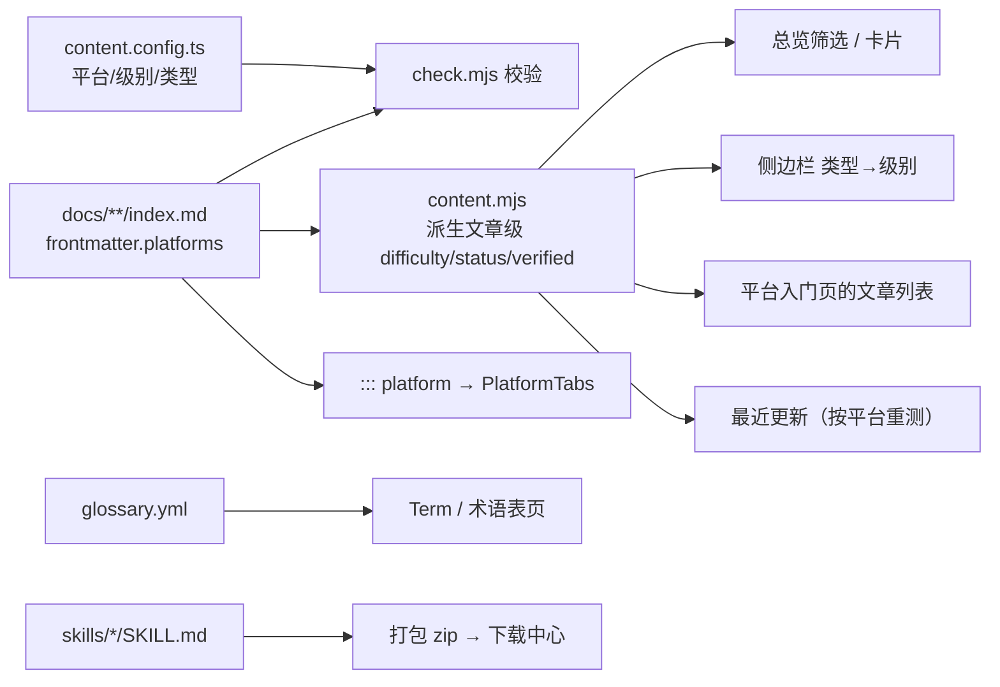

# AI 提效指南（WorkSmarterWithAI）· 设计文档

> 版本 v0.2 · 2026-11-16 · 状态：已确认方向，待实施（待定事项见第 12 节）
>
> 项目名：AI 提效指南 · 仓库名 `WorkSmarterWithAI` · 域名待定。

### v0.2 相对 v0.1 的主要变化

1. **读者分三层**：新手、在用 AI 的人、AI 从业者 / 开发者。同一篇文章分两层写，浅的在前、深的折叠在后（第 1、4.3 节）。
2. **级别按「需要会什么」定义**：入门 / 进阶 / 高级，**按平台分别标注**（第 2.3 节）。
3. **新增「平台」维度**：每篇 Skill 教程包含 **知办、豆包工作、WorkBuddy、Codex** 四个平台的使用教程，用标签页切换，读者的选择全站记住（第 2.4、4.4 节）。
4. **三大分类恢复为 Skill（技能）/ 工作流 / AI 应用**。提示词归入 Skill，作为入门形态，用 `format` 区分（第 2.1 节）。
5. **新增平台入门页**（`/platforms/<平台>/`），放通用的安装和导入步骤，文章里不再重复（第 3.2 节）。
6. **专业感靠数据**：每个平台单独记录实测日期、版本和结果，文末附测试记录（第 4.5 节）。

### 与当前实现（commit `044e132`）的关系

需要**保留**的：大白话写法、`PromptBox` 一键复制、`ArticleSummary` 标题下信息行、真实截图、「只展示有内容的分类」、`unverified` 不造假等 AGENTS.md 规则。

需要**调整**的：
- 分类名「现成指令 / 工作步骤 / 工具入门 / 进阶知识」改回 Skill（技能）/ 工作流 / AI 应用。
- Skill 不再藏在「更多」菜单里。
- 难度从整篇一个值改为按平台标注。
- 补上平台维度。

---

## 1. 定位

**一句话**：一本开源、持续更新的手册，按行业讲清楚哪些 Skill、工作流、AI 应用真正好用、在常用平台上怎么用、效果怎样，并附上作者自己开发的工具。

**三层读者，同一套内容**：

| 读者 | 他要什么 | 在哪里得到 |
|---|---|---|
| 新手（第一次用 AI） | 打开哪个工具、粘贴什么、点哪里、得到什么 | 文章前半部分：大白话步骤 + 截图 |
| 在用 AI 的人 | 换个平台怎么用、怎么改造、怎么组合 | 平台标签页 +「进阶玩法」折叠块 |
| AI 从业者 / 开发者 | 原理、跨平台差异、成本、失败案例、测试数据 | 「给懂行的人」折叠块 + 文末测试记录 + Codex 标签页 |

**原则**：
1. **实测为准**：每个平台单独写明实测日期和版本，没测过的不写成测过。
2. **结论先行**：标题下一行就是适合谁、用时、花费、支持哪些平台。
3. **能直接拿走**：一个技能包四个平台通用，页面上可一键复制，也可下载。
4. **语言浅、内容可深**：全站用短句和大白话；高级内容可以用术语，但首次出现必须解释。
5. **全程开源**：正文、配置、源码都在 GitHub，接受纠错和实测投稿。

---

## 2. 内容分类

### 2.1 三大类型（`type`）× 文章性质（`kind`）

| | **教程** `guide` | **评测** `review` | **自研** `original` |
|---|---|---|---|
| **Skill（技能）** `skill` | 某个技能怎么装、怎么用 | 同类技能横评 / 深度测评 | 作者写的技能，附下载 |
| **工作流** `workflow` | 完成一件具体工作的步骤 | 不同平台、不同方案对比 | 作者搭的流程，附导出文件 |
| **AI 应用** `app` | 某个产品怎么上手 | 产品测评、横评 | 作者开发的应用 |

**归类规则**（写在 CONTRIBUTING.md 里，避免分错类）：
- **Skill（技能）**：可复用、可导入或可复制给 AI 的能力包。
- **工作流**：完成一件具体工作的多个步骤，可以是手动分步，也可以是平台上搭好的自动化流程。
- **AI 应用**：讲一个产品本身怎么用、值不值得用。

**Skill 的形态**（`format`，卡片上显示小标签）：

| format | 中文名 | 说明 | 常见级别 |
|---|---|---|---|
| `prompt` | 提示词 | 复制给任意 AI 就能用的一段话 | 入门 |
| `skill` | 技能包 | 带 `SKILL.md` 的文件夹，可导入平台 | 入门（图形界面）/ 进阶（Codex） |
| `mcp` | MCP 连接 | 让 AI 连上外部工具或数据 | 进阶 / 高级 |

当前的「现成指令」并入 Skill，记为 `format: prompt`。原 `/prompts/` 列表页改为跳转到 `/skills/?format=prompt`。

### 2.2 辅助维度

| 维度 | 字段 | 取值示例 | 用途 |
|---|---|---|---|
| 平台 | `platforms`（见 2.4） | 知办、豆包工作、WorkBuddy、Codex | 标签页、平台页、筛选 |
| 级别 | 按平台记录（见 2.3） | 入门 / 进阶 / 高级 | 徽章、筛选、学习路线 |
| 行业 | `industry` | 通用、新媒体、电商、行政人事、教育…… | 行业页、筛选 |
| 其他工具 | `tools` | DeepSeek、n8n、Dify、Coze…… | 非四大平台的工具，筛选用 |
| 花费 | `cost` | 免费额度内 / 免费 / 低 / 中 / 高 | 筛选 |
| 场景 | `tags` | 写作、会议、表格、合同…… | 搜索 |

所有取值只在 `content.config.ts` 里定义，写错会被 CI 拦下。

### 2.3 级别：按「需要会什么」定义

| 级别 | 读者需要会什么 | 典型用时 | 徽章颜色 | 卡片上的说明 |
|---|---|---|---|---|
| **入门** | 打开网页或客户端，点按钮、拖文件、复制粘贴 | 10 分钟内 | 绿 | 会复制粘贴就行 |
| **进阶** | 改造现成技能、组合多个技能、配连接器；或在 Codex 里装、用技能 | 30~60 分钟 | 蓝 | 要装软件 / 会配置 |
| **高级** | 自己写 `SKILL.md`、加脚本、跨平台适配、发布到技能市场、写 MCP | 半天以上 | 紫 | 要会命令行 / 写代码 |

- **级别按平台分别标注**。同一个技能，在豆包工作里通常是入门，在 Codex 里通常是进阶。
- 文章级的「最低级别」= 各平台级别中最低的那个，用于「入门可做」筛选和学习路线。
- 每个平台另写**前置条件**（需要什么账号、客户端版本、是否付费）和**预计用时**（不含登录，没找新手实测计时就不写成已验证）。

**三类内容在三个级别上的典型题材**：

| | 入门 | 进阶 | 高级 |
|---|---|---|---|
| Skill（技能） | 复制即用的提示词；在图形界面平台导入现成技能 | 改造、组合技能；在 Codex 里使用；接连接器 | 自己写技能并发布；写 MCP |
| 工作流 | 在对话里分几步手动完成 | 在 Coze、Dify、飞书多维表格里拖拽搭建 | n8n 自托管、API、定时触发、多 Agent |
| AI 应用 | 某个产品第一次怎么用 | 知识库、项目、深度研究、自建智能体 | API 调用、本地部署、模型横评 |

### 2.4 平台维度：四个主平台

| 平台 | slug | 操作方式 | 默认级别 | 导入技能的方式（以官方文档为准） | 标签页顺序 |
|---|---|---|---|---|---|
| 豆包工作 | `doubao` | 图形界面 | 入门 | 「插件·技能·伙伴 → 技能 → 添加 → 上传技能」；对话框输入 `/` 或 `@` 调用。要求技能包里有带 YAML 头的 `SKILL.md` | 1 |
| WorkBuddy | `workbuddy` | 图形界面 | 入门 | 「添加技能 → 上传技能」拖入技能包；也可从技能市场安装 | 2 |
| 知办 | `zhiban` | 图形界面（待确认） | 入门（待确认） | 待确认官网和文档 | 3 |
| Codex | `codex` | 命令行 / 客户端 | 进阶 | 放入 Codex 的技能目录（全局或项目级，以官方文档为准） | 4，标「开发者」 |

- 平台的名称、slug、官网、文档链接、默认级别、排序都放在 `content.config.ts` 的 `platforms` 里，以后加千问办公等平台只改配置。
- **四个平台用同一份技能包**：标准 `SKILL.md`（YAML 头含 `name`、`description`）+ 可选的辅助文件。不为每个平台维护一个版本；某个平台需要特殊处理的，写进该平台标签的注意事项。

**哪些文章必须有四个平台标签**：

| 类型 | 规则 |
|---|---|
| Skill（`format: skill`） | **必须**有四个平台标签。某平台不支持就标「暂不支持」并写明原因，不删标签 |
| Skill（`format: prompt`） | 提示词在任何对话 AI 里都能用。默认给豆包工作的截图步骤，其余平台合并成一句「粘贴到对话框即可」，不强制四个标签 |
| 工作流 | 能在哪些平台搭，就给哪些平台的标签；只适合单一平台的（如 n8n），写成单平台文章 |
| AI 应用 | 讲的是某一个产品，不用平台标签。四个平台本身就是 AI 应用的评测题材 |

### 2.5 专题（第二阶段）

跨类型串联，例如「行政的一天：2 个技能 + 1 个工作流」。放在 `docs/topics/`，以引用其他文章为主。

---

## 3. 信息架构

### 3.1 顶部导航

```
新手开始 | Skill（技能） | 工作流 | AI 应用 | 按平台 ▾ | 按行业 | 全部教程 | 更多 ▾（最近更新 / 下载 / 术语表 / 评测规则 / 关于 / 参与贡献）
```

「按平台」下拉里放四个平台入门页。只有一个平台有内容时，下拉里也只显示有内容的平台。

### 3.2 页面清单

| 页面 | 路径 | 说明 |
|---|---|---|
| 首页 | `/` | 两个问题选入口（见 3.3）、第一课、最新内容 |
| 新手开始 | `/start/` | 入门学习路线，按顺序 3~5 篇 |
| 学习路线 | `/paths/beginner/`、`/paths/intermediate/`、`/paths/advanced/` | 三个级别各一条路线，按顺序列文章 |
| 类型首页 | `/skills/`、`/workflows/`、`/apps/` | 说明 + 按级别分组的文章列表 |
| 文章页 | `/skills/<slug>/` 等 | 见第 4 节模板 |
| **平台入门页** | `/platforms/<slug>/` | 平台简介、安装、注册与价格（截至日期）、**怎么导入任何技能**、怎么调用、该平台的全部教程 |
| 行业页 | `/industries/<slug>/` | 只为有内容的行业生成入口 |
| 总览筛选 | `/catalog/` | 见 3.5 |
| 术语表 | `/glossary/` | Skill、MCP、Agent、token、API Key 等，一句大白话 + 延伸阅读 |
| 最近更新 | `/changelog/` | 新增 / 更新 / 重测，**重测按平台记录** |
| 下载中心 | `/downloads/` | 所有技能包、工作流文件 |
| 关于类 | `/about/`、`/contribute/`、`/review-policy/` | |

原来的 `/tools/<tool>/` 页面：四大平台改由 `/platforms/` 承担；其他工具页只在有内容时生成。

### 3.3 首页：两个问题选入口

1. **你现在是？**
   - 我刚开始用 AI → `/start/`
   - 我已经在用 AI → `/paths/intermediate/`
   - 我是开发者 / 从业者 → `/paths/advanced/` + 评测 + 自研下载
2. **你用哪个工具？**（四个平台按钮，下面加一行「还没有，帮我选」）
   - 点了之后保存为全站偏好（见 4.4），首页推荐、筛选默认值、文章默认标签都跟着变。
   - 页面上能看到当前选择，可以随时改。

保留现在的「第一课」卡片和大白话风格。去掉「不用懂代码」这类绝对说法，改成「新手跟着做就会，懂行的人也有干货」。

### 3.4 左侧边栏

- 结构：**类型 → 级别 → 文章**。例如「Skill（技能）→ 入门 → 文章标题」。
- 一个分组只有一篇时，不再单独套一层，直接列文章。
- 由脚本根据 frontmatter 自动生成，`order` 控制排序。

### 3.5 总览筛选页

- 筛选顺序：**平台 → 级别 → 类型 → 行业 → 性质 → 花费**，外加「只看已实测」「只看 30 天内更新」「只看自研」。
- **平台和级别联动**：选了「豆包工作 + 入门」，只显示在豆包工作上是入门级别的文章。
- **只显示有内容的选项**，每个选项后面显示篇数；0 篇的选项不显示。
- 卡片显示：标题、一句话简介、类型和 format 标签、**四个平台小图标及状态**（已实测 / 待实测 / 即将补充 / 不支持）、最低级别徽章、花费。
- 筛选状态写进 URL（如 `/catalog/?platform=doubao&level=入门`），方便分享。

---

## 4. 文章规范

### 4.1 Frontmatter

```yaml
---
title: 让 AI 先问清楚你要什么，再动手
description: 装上这个技能，AI 会先列出它需要知道的信息，确认后再写，减少返工。
type: skill                  # skill | workflow | app
format: skill                # 仅 Skill：prompt | skill | mcp
kind: original               # guide | review | original
industry: [通用, 新媒体]
tools: []                    # 四大平台以外的工具
cost: 免费额度内
tags: [需求确认, 写作]
time: 10 分钟（不含登录）     # 文章级预计用时；没有实测计时就写「约」
created: 2026-11-16
updated: 2026-11-16
sponsored: false
authors: [zbwork]

platforms:                   # Skill（format: skill）必填四个；其他类型按需
  doubao:
    level: 入门
    status: active           # active | unverified | planned | unsupported | outdated
    verified: 2026-11-16
    version: 豆包 PC 客户端 x.y.z
    prerequisites: 已登录豆包账号
  workbuddy:
    level: 入门
    status: unverified
    verified: null
    version: null
  zhiban:
    level: 入门
    status: planned          # 即将补充
  codex:
    level: 进阶
    status: unverified
    verified: null
    prerequisites: 已安装 Codex，会用终端

# 仅自研
source: skills/task-brief
download: /downloads/task-brief.zip
license: MIT

# 仅评测
rating: 4.2
---
```

**派生规则**（由脚本计算，作者不用手写）：

- 文章级 `difficulty` = 各平台 `level` 中最低的一级。
- 文章级 `status`：
  - 有任一平台 `active` → `active`；
  - 全部是 `unverified` / `planned` → `unverified`；
  - 原来 `active` 的平台全部变成 `outdated` → `outdated`。
- 文章级 `verified` = 各平台 `verified` 中最近的一个日期，用于「最近更新」。

**校验规则**（CI）：

- `format: skill` 的文章，`platforms` 必须包含 `content.config.ts` 中全部主平台。
- `status: active` 的平台，必须有 `verified` 和 `version`；正文对应标签里必须至少有一张该平台的真实截图。
- `planned` / `unsupported` 的平台，不能写具体操作步骤：`planned` 显示统一的「即将补充」提示，`unsupported` 必须写原因。
- **Skill 的发布标准**：`format: skill` 的文章至少 2 个平台 `active` 才能发布到默认列表；不足 2 个的标记为「草稿」，只在 `/catalog/?draft=1` 可见。

### 4.2 过期机制（按平台）

- 某平台 `verified` 超过 90 天：**只在该平台标签上**提示「该平台 90 天未复测」，卡片上该平台图标变灰。
- 所有 `active` 平台都过期时，文章顶部再加整体提示。
- `stale.yml` 每周把过期的「文章 × 平台」列进一个固定 Issue，作为复测清单。

### 4.3 Skill 文章模板（核心）

```markdown
# 标题：说清楚做完得到什么

<ArticleSummary />
<!-- 一行：适合谁 · 用时 · 花费 · 支持平台：豆包工作 ✅ WorkBuddy ⏳ 知办 🕓 Codex ⏳ -->

一两句话：这个技能解决什么问题。

## 做完是什么样
一张效果截图或 30 秒短视频（平台无关，用任一已实测平台的结果）。

## 获取技能包
<Download file="/downloads/task-brief.zip" />
<PromptBox>SKILL.md 的核心内容，可一键复制</PromptBox>

## 在你用的平台上使用

::: platform doubao
**入门** · 前置条件：已登录豆包账号
1. 导入技能（截图）
2. 调用技能（截图）
3. 得到的结果（截图）
注意事项：……
:::

::: platform workbuddy
……
:::

::: platform zhiban
:::

::: platform codex
**进阶** · 前置条件：已安装 Codex，会用终端
……
:::

## 常见问题
（平台共有的问题）

::: details 进阶玩法
怎么改这个技能、和其他技能组合、接连接器
:::

::: details 给懂行的人
SKILL.md 逐段解读 · 为什么这样设计 · 四个平台的兼容差异 · 成本 / token · 失败案例 · 替代方案
:::

## 测试记录
<PlatformTestTable />   <!-- 从 frontmatter 自动生成：平台 · 日期 · 版本 · 结果 -->
```

- 连续的 `::: platform` 块会自动合并成一组标签页（见 4.4）。
- 平台标签里**只写这个技能特有的步骤**。通用的「怎么导入技能」放在平台入门页，标签里写一句「第一次导入技能？先看 [豆包工作入门](/platforms/doubao/)」。
- 工作流、AI 应用、评测、自研的模板保留原结构，同样加上「做完是什么样」、两个折叠块和测试记录。有平台差异的工作流，同样使用 `::: platform`。

### 4.4 平台标签页的交互

- **默认显示哪个平台**，优先级依次是：
  1. URL 参数 `?platform=codex`（方便分享给别人）；
  2. 读者保存的偏好（localStorage，全站共用一个 key）；
  3. 配置里排第一的平台。
- 读者在任意一篇文章里切换标签，都会更新偏好，其他文章自动跟随。
- 每个标签头显示：平台名 + 级别徽章 + 状态小图标。Codex 标签加「开发者」字样。
- `planned`：显示「这个平台的教程即将补充，欢迎投稿实测 →」，链接到投稿 Issue 模板。
- `unsupported`：显示原因，并推荐能用的平台。
- **所有平台的内容都输出在 HTML 里**（只是隐藏未选中的），保证站内搜索、SEO、`llms-full.txt` 能收录全部平台的步骤。
- 手机上标签头可以横向滑动，不换行挤压。

### 4.5 专业度：测试记录规范

每个 `active` 平台都要记录以下内容，汇总在文末「测试记录」表：

| 字段 | 说明 |
|---|---|
| 日期 | 实测日期 |
| 平台版本 | 客户端 / 网页版本号；页面上看不到版本时写明「页面未显示版本」 |
| 模型 | 能看到就写 |
| 输入 | 使用的测试材料（虚构或脱敏），放在文中或附件里 |
| 结果 | 成功 / 部分成功 / 失败，以及人工改了几处 |
| 次数 | 跑了几次、成功几次 |
| 备注 | 失败原因、修正过程 |

评测类文章继续使用第 4.6 节的统一评分规则。

### 4.6 评测规则

不变：效果 30%、易用 20%、稳定 20%、成本 20%、生态 10%；没有测试记录不打分；有合作必须披露。四平台横评使用同一份测试用例。

### 4.7 写作风格

- **语言深浅全站一致，内容深浅分层**：高级内容也用短句和大白话。
- 写明打开哪个工具、粘贴什么、点哪里、得到什么（保留 AGENTS.md「写给新手」的全部规则）。
- **术语不删，但必须解释**：每篇第一次出现时用 `<Term>` 标出，例如 `<Term id="mcp">MCP</Term>`。鼠标悬停（手机上点按）显示一句话解释，并链接到术语表。术语的解释统一维护在 `glossary.yml`。
- 正文前半部分（新手区）不出现命令行；命令行只出现在 Codex 标签和「给懂行的人」折叠块里。
- 截图里的账号、手机号、客户信息一律打码；价格写明「截至某日」。

---

## 5. 图片与视频

- 图片和文章放在一起，按平台和步骤命名：`images/doubao-01-import.webp`、`images/codex-02-run.webp`。
- 平台入门页的通用截图放在 `docs/platforms/<slug>/images/`，供各文章链接引用，不重复截。
- 规格不变：WebP、宽 ≤ 1600px、≤ 300KB、`alt` 必填；示意图必须标明「示意」，不能冒充实际输出。
- 视频不进仓库：长视频放 B 站（嵌入）；短演示放对象存储，用 `<Clip>`。
- 平台改版导致截图过时：把该平台 `status` 改成 `outdated`，等补截图。

---

## 6. 项目架构

### 6.1 技术选型

不变：VitePress 1.6、Vue 3、Node 22.18+、pnpm 10、本地搜索（中文分词）、Mermaid、RSS、llms.txt、GitHub Pages（可迁 Cloudflare Pages）。

### 6.2 目录结构（只列新增和变化）

```
WorkSmarterWithAI/
├── content.config.ts                  # 新增 platforms、levels（含「需要会什么」说明）；types 改回 skill/workflow/app
├── glossary.yml                       # 新增：术语表数据
├── docs/
│   ├── .vitepress/
│   │   ├── config.mts                 # 导航调整；注册 ::: platform 容器（markdown-it-container）
│   │   ├── sidebar.mts                # 改为 类型 → 级别 → 文章
│   │   └── theme/components/
│   │       ├── PlatformTabs.vue       # 新增：合并连续 platform 块为标签页，记住偏好
│   │       ├── PlatformBadges.vue     # 新增：卡片和信息行上的四平台状态图标
│   │       ├── PlatformPicker.vue     # 新增：首页「你用哪个工具」
│   │       ├── LevelBadge.vue         # 新增：入门 / 进阶 / 高级 徽章
│   │       ├── Term.vue               # 新增：术语悬停解释
│   │       ├── PlatformTestTable.vue  # 新增：文末测试记录表
│   │       ├── ArticleSummary.vue     # 调整：加入平台与级别
│   │       ├── ArticleCard.vue        # 调整：加入平台图标、format 标签
│   │       └── Catalog.vue            # 调整：平台 × 级别联动，隐藏 0 篇选项
│   ├── platforms/                     # 新增：四个平台入门页
│   │   ├── index.md
│   │   ├── doubao/index.md
│   │   ├── workbuddy/index.md
│   │   ├── zhiban/index.md
│   │   └── codex/index.md
│   ├── paths/                         # 新增：三条学习路线
│   ├── glossary/index.md              # 新增
│   ├── skills/  workflows/  apps/     # 不变；prompts/ 改为跳转
│   └── ...
├── skills/<slug>/
│   ├── SKILL.md                       # 新增要求：标准 YAML 头（name、description），四平台通用
│   ├── prompt.md                      # 可选：给只想复制提示词的人
│   └── README.md
├── templates/
│   ├── skill.md                       # 新增：四平台 Skill 模板（第 4.3 节）
│   └── guide.md / review.md / original.md   # 调整：加折叠块和测试记录
└── scripts/
    ├── content.mjs                    # 调整：派生 difficulty / status / verified
    ├── check.mjs                      # 调整：第 4.1 节的平台校验
    └── check-stale.mjs                # 调整：按平台检查过期
```

### 6.3 数据流



---

## 7. 自研内容的管理

- **技能**：`skills/<slug>/SKILL.md` 是唯一源文件，四个平台共用。打包后的 zip 解压出来就是一个技能文件夹，可以直接拖进豆包工作和 WorkBuddy，也可以放进 Codex 的技能目录。
- 现有的 `skills/task-brief/` 只有 `prompt.md`，需要补一个标准 `SKILL.md`，才能作为四平台 Skill 教程的第一篇。
- **工作流**：放导出文件 + README，导出前去掉密钥，CI 扫描密钥。
- **AI 应用**：单独建仓库，手册只放介绍和链接。

---

## 8. 构建、部署与更新

沿用 v0.1：ci / deploy / release / stale 四条流水线。变化：

- `stale.yml` 按「文章 × 平台」列复测清单。
- 「最近更新」里的「重测」写明是哪个平台，例如「豆包工作 重测」。

---

## 9. 开源协作

- 新增 Issue 模板「**平台实测投稿**」：读者可以投稿某篇文章在某个平台上的截图和测试记录，补上 `planned` 的平台。
- 投稿的截图要求原图、打码，并写明日期和版本。
- 其余不变：正文 CC BY 4.0，代码 MIT。

---

## 10. 和 AI 的结合

不变：`handbook-skill/`、`llms.txt`、`llms-full.txt`、Markdown 原文。

`handbook-skill/` 也做成标准 `SKILL.md`，同样提供四平台的安装说明。

---

## 11. 分阶段计划

| 阶段 | 内容 |
|---|---|
| **P1 结构**（本次） | 类型改回三类；`platforms` 数据结构与校验；`::: platform` 标签页；级别徽章；侧边栏和导航；四个平台入门页骨架；首页两个问题；术语组件 |
| **P2 首批内容** | 3 篇 Skill（入门 / 进阶 / 高级各 1 篇），每篇至少 2 个平台实测；4 个平台入门页补真实截图；现有 6 篇按新分类迁移 |
| **P3 扩展** | 工作流和 AI 应用补平台标签；四平台横评；学习路线补齐；平台实测投稿流程 |
| **P4** | 专题、英文版、国内镜像、PDF（按需） |

**现有内容迁移**：

| 现有文章 | 新类型 | format | 说明 |
|---|---|---|---|
| 让 AI 先问清楚你要什么（task-brief） | Skill | skill | 补 `SKILL.md`，作为第一篇四平台 Skill 教程 |
| 提示词、Skill、MCP，到底是什么？ | Skill | — | 概念入门文章，同时作为术语表的延伸阅读 |
| 把会议记录变成待办表 | 工作流 | — | 保留豆包实测；其他平台按需加标签 |
| 把访谈记录变成文章初稿 | 工作流 | — | |
| 用豆包整理商品评论 | 工作流 | — | 讲的是完成一件工作，不是产品本身 |
| 第一次用豆包：发出第一条消息 | AI 应用 | — | 内容并入豆包工作平台入门页，原 URL 保留 |

---

## 12. 待定事项

1. **「知办」的官网和文档**：目前没查到这个产品的官方资料。确认前，知办标签统一显示 `planned`，不写操作步骤。
2. **「豆包办公」还是「豆包工作」**：官方帮助中心的名称是「豆包工作」。全站显示名在 `content.config.ts` 里统一配置。
3. **各平台的付费情况**：入门页上的价格要写明截至日期。
4. 域名、是否接受商业合作、英文版：同 v0.1。

**参考**：
- [豆包工作：使用技能](https://www.doubao.com/work/docs/zh-cn/articles/081010973544-skills)
- [WorkBuddy：技能](https://www.workbuddy.cn/docs/workbuddy/From-Beginner-to-Expert-Guide/Function-Description/Skills-Market)
