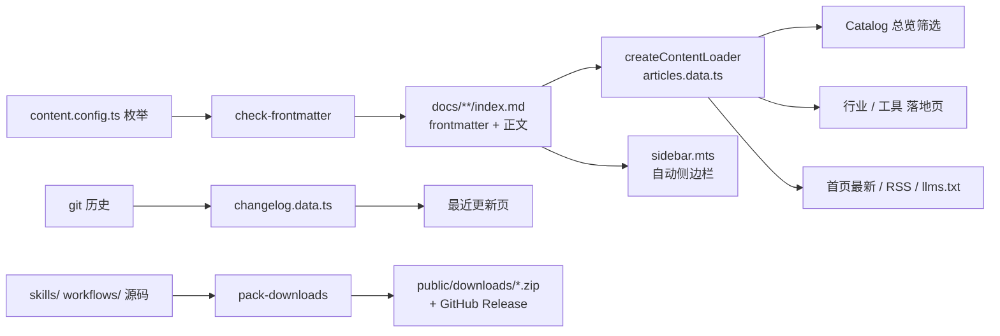

# AI 提效指南（WorkSmarterWithAI）· 设计文档

> 版本 v0.1 · 2026-11-16 · 状态：草案，待确认（见第 12 节「待定事项」）
>
> 项目名：AI 提效指南 · 仓库名 `WorkSmarterWithAI` · 域名待定。

---

## 1. 定位

**一句话**：一本开源、持续更新的手册，按行业讲清楚哪些 Skill、工作流、AI 应用真正好用，怎么用，效果怎样，并附上作者自己开发的工具。

**读者**：
- 想用 AI 提效、但不知道从哪开始的各行业从业者（法务、财务、电商、运营、设计、教育、开发……）
- 已经在用 Claude Code / Codex / Cursor / Dify / Coze / n8n 等工具，想找现成 Skill 和工作流的人

**原则**：
1. **实测为准**：每篇都写明最后实测的日期和工具版本，过期会自动标出来。
2. **结论先行**：开头就告诉读者「适合谁、要花多少、值不值」。
3. **能直接拿走**：自研的 Skill、工作流都给出能下载的文件，不只是截图。
4. **全程开源**：正文、配置、工具源码都在 GitHub，接受纠错和投稿。

**参考对象**：
- 形态：VitePress 默认主题（文档阅读体验，对应参考图 2）+ 一个可筛选的卡片总览页（对应参考图 1，HowToLiveBetter）
- 机制：借鉴 HowToLiveBetter 的「条目标签筛选、最近更新、CI 校验、手册本身做成 Skill」

---

## 2. 内容分类

### 2.1 两个主维度：内容类型 × 文章性质

| | **教程** `guide` | **评测** `review` | **自研** `original` |
|---|---|---|---|
| **Skill** `skill` | 某个 Skill 怎么装、怎么用 | 同类 Skill 横评 / 单个深度测评 | 自己写的 Skill，附下载 |
| **工作流** `workflow` | 某个工作流的搭建步骤 | 不同平台、不同方案的对比 | 自己搭的工作流，附导出文件 |
| **AI 应用** `app` | 某个 AI 产品的上手教程 | 产品测评、横评 | 自己开发的 AI 应用 |

- **Skill**：Claude Code / Codex 等 Agent 的 Skill（SKILL.md）、插件、MCP Server、提示词包等"装进 AI 里用的能力包"。
- **工作流**：n8n、Dify、Coze、ComfyUI、飞书多维表格自动化、Make/Zapier 等平台上的流程，以及"多个工具串起来完成一件事"的人工流程。
- **AI 应用**：面向终端用户的独立产品（对话、写作、绘图、视频、语音、编程、搜索等）。

### 2.2 辅助维度

| 维度 | 字段 | 取值示例 | 用途 |
|---|---|---|---|
| 行业 | `industry` | 通用、法律、财务、电商、新媒体、设计、教育、医疗、开发、行政人事…… | 行业落地页、筛选 |
| 工具/平台 | `tools` | Claude Code、Codex、Cursor、Dify、Coze、n8n、ComfyUI…… | 筛选、工具聚合页 |
| 难度 | `difficulty` | 入门 / 进阶 / 高级 | 筛选 |
| 花费 | `cost` | 免费 / 低（<¥50/月）/ 中 / 高 | 筛选 |
| 场景 | `tags` | 写作、数据分析、合同、客服、短视频…… | 自由标签，搜索 |

行业和工具的取值**集中定义在一个文件里**（`content.config.ts`，见 6.2），写错会被 CI 拦下，免得出现「电商」「电子商务」两种写法。

### 2.3 专题（可选，第二阶段）

跨类型的串联内容，比如「律师的一天：用 3 个 Skill + 1 个工作流处理合同」。放在 `docs/topics/`，正文以引用其他文章为主。

---

## 3. 信息架构（站点结构）

### 3.1 顶部导航

```
首页 | Skill | 工作流 | AI 应用 | 按行业 ▾ | 总览筛选 | 最近更新 | 关于 ▾（贡献指南 / 评测规则 / 下载）
```

### 3.2 页面清单

| 页面 | 路径 | 说明 |
|---|---|---|
| 首页 | `/` | 定位介绍、精选、最新 5 篇、按行业入口 |
| 类型首页 | `/skills/`、`/workflows/`、`/apps/` | 该类型的说明和文章列表（按 教程/评测/自研 分组） |
| 文章页 | `/skills/<slug>/` | 正文，左侧目录，右侧「本页目录」 |
| 行业落地页 | `/industries/<industry>/` | 动态路由自动生成，列出该行业所有文章 |
| 工具聚合页 | `/tools/<tool>/` | 动态路由，列出某工具相关全部文章（第二阶段） |
| **总览筛选** | `/catalog/` | 参考图 1：左侧筛选条件，右侧卡片，支持组合筛选和搜索 |
| 最近更新 | `/changelog/` | 按日期列出新增和修改，区分「新增」「重测」「修正」 |
| 下载中心 | `/downloads/` | 所有自研 Skill / 工作流文件的下载汇总 |
| 关于 | `/about/`、`/contribute/`、`/review-policy/` | 作者、贡献指南、评测规则和利益披露 |

### 3.3 左侧边栏

- 每个类型一套侧边栏，按 **性质（教程 / 评测 / 自研）→ 行业** 两级分组。
- 侧边栏**由脚本根据 frontmatter 自动生成**，新增文章不用手改配置。
- 文章可以在 frontmatter 里用 `order` 字段调整排序。

### 3.4 总览筛选页（`/catalog/`）

- 筛选条件：类型、性质、行业、工具、难度、花费、「只看 30 天内更新」「只看自研」
- 卡片内容：标题、一句话简介、标签徽章、评分（仅评测）、实测日期、过期标记
- 数据来源：构建时读取全部文章的 frontmatter（VitePress `createContentLoader`），不需要单独维护 JSON
- 筛选状态写进 URL 参数（如 `/catalog/?industry=法律&type=skill`），方便分享

---

## 4. 文章规范

### 4.1 Frontmatter 字段

```yaml
---
title: 用 Claude Code 批量审查合同条款
description: 一个 Skill 把合同里的高风险条款挑出来，附修改建议   # 一句话简介，卡片和 SEO 用
type: skill                 # skill | workflow | app
kind: original              # guide | review | original
industry: [法律, 行政人事]
tools: [Claude Code]
difficulty: 入门            # 入门 | 进阶 | 高级
cost: 免费                  # 免费 | 低 | 中 | 高
tags: [合同, 风险审查]

created: 2026-11-10
updated: 2026-11-16         # 内容实质修改日期
verified: 2026-11-16        # 最后一次实测日期（关键字段）
version: Claude Code 2.x    # 实测时的工具版本

status: active              # active | outdated | deprecated
cover: ./images/cover.webp  # 可选，卡片封面

# 仅评测
rating: 4.2                 # 总分，满分 5
sponsored: false            # 是否有商业合作，必填

# 仅自研
download: /downloads/contract-review.zip
source: skills/contract-review       # 仓库内源码目录
license: MIT
---
```

**必填**：`title`、`description`、`type`、`kind`、`industry`、`tools`、`difficulty`、`created`、`verified`、`status`
**评测必填**：`rating`、`sponsored`
**自研必填**：`download` 或 `repo`（之一）、`source`、`license`

### 4.2 过期机制

- `verified` 距今 **超过 90 天**：文章顶部自动显示「该内容 90 天未复测，可能已变化」，卡片上加灰色标记。
- CI 每周跑一次，把过期文章列成一个 Issue，作为复测待办清单。
- 工具已经下线或被替代的，改 `status: deprecated`，从总览默认结果中隐藏，但保留页面（外链不失效）。

### 4.3 正文模板

**教程（guide）**
```
> 一句话结论：适合谁、能省多少事、要花多少
## 能解决什么问题
## 准备工作（账号、费用、环境）
## 操作步骤（分步截图 / 视频）
## 实际效果（输入 → 输出示例）
## 常见问题
## 相关推荐
```

**评测（review）**
```
> 结论先行：总分、一句话评价、适合 / 不适合谁
## 评分表（按 4.4 的维度）
## 测试方法（日期、版本、环境、测试用例）
## 实测过程（截图 / 视频）
## 优点 / 缺点
## 价格
## 替代方案对比
## 利益披露
```

**自研（original）**
```
> 它是什么、解决什么问题、下载按钮
## 效果演示（短视频优先）
## 安装
## 使用方法
## 原理 / 设计思路（可选）
## 已知限制
## 更新日志
## 反馈渠道
```

模板文件放在 `templates/`，新建文章时用脚本复制（`pnpm new skill guide contract-review`）。

### 4.4 评测规则

- **统一评分维度**（满分 5，保留一位小数），保证横向可比：

  | 维度 | 说明 |
  |---|---|
  | 效果 | 产出质量、准确率 |
  | 易用 | 上手门槛、配置复杂度 |
  | 稳定 | 出错率、可复现性 |
  | 成本 | 价格、token 消耗、时间投入 |
  | 生态 | 文档、社区、可扩展性 |

- 总分 = 加权平均，不同类型可以有不同权重，权重公开写在 `/review-policy/`。
- 必须写明测试日期、版本、测试用例；同一个横评里的测试用例要一致。
- 有商业合作必须 `sponsored: true`，页面自动加披露提示；合作不影响打分规则。

### 4.5 写作风格

- 说人话，少用行话；英文缩写第一次出现时给中文解释（可以维护一个术语表，自动加悬浮解释，第二阶段）。
- 截图里的账号、密钥、手机号、客户信息一律打码。
- 价格写明「截至某日」。

---

## 5. 图片与视频

### 5.1 图片

- **跟文章放在一起**：`docs/skills/contract-review/images/xxx.webp`，在正文里用相对路径引用，VitePress 构建时会自动处理和加 hash。
- **格式和体积**：统一 WebP，宽度 ≤ 1600px，单张 ≤ 300KB；`alt` 文字必填。
- **压缩**：提供 `pnpm img` 脚本（基于 sharp）批量把 png/jpg 转成 webp 并压缩；CI 检查超标图片。
- **点击放大**：接入 medium-zoom，长截图可以点开看。
- **命名**：`01-安装.webp`、`02-配置.webp`，按步骤编号，方便对照正文。

### 5.2 视频

**视频文件不进 Git 仓库**（会让仓库迅速膨胀，GitHub Pages 和 Cloudflare Pages 也有单文件大小限制）。

| 场景 | 方案 | 组件 |
|---|---|---|
| 完整教程（几分钟以上） | 传到 B 站（主）+ YouTube（备），页面里嵌入播放器 | `<VideoEmbed bilibili="BV..." youtube="..." />` |
| 短演示（10~60 秒，替代 GIF） | mp4/webm 放到对象存储（Cloudflare R2 / 阿里云 OSS），自动播放、静音、循环 | `<Clip src="..." poster="./images/xx.webp" />` |
| 封面 / 预览 | 视频首帧截图放在文章 `images/` 下 | — |

- `VideoEmbed` 组件：默认显示 B 站，有 YouTube 时提供切换；点击后才加载 iframe（懒加载，不拖慢页面）。
- 对象存储路径规范：`media/<type>/<slug>/<文件名>.mp4`，例如 `media/skills/contract-review/demo.mp4`。
- 短视频建议用 H.264 mp4，720p，单个 ≤ 10MB。

### 5.3 其他富媒体

- 代码块：VitePress 自带高亮、行号、行高亮、代码组（多平台切换）。
- 提示框：`::: tip` / `::: warning` / `::: danger` 自带。
- 流程图：接入 Mermaid 插件，工作流文章用它画节点关系。
- 下载按钮：`<Download file="/downloads/xxx.zip" />` 组件，显示文件大小和更新时间。

---

## 6. 项目架构

### 6.1 技术选型

| 部分 | 选型 | 说明 |
|---|---|---|
| 站点框架 | VitePress（最新稳定版） | 文档主题、Markdown 扩展、Vue 组件 |
| 运行环境 | Node 22 LTS + pnpm | |
| 搜索 | VitePress 本地搜索（配置中文分词） | 文章过千篇后改用 Algolia DocSearch（开源项目免费） |
| 图片处理 | sharp（脚本）+ medium-zoom（前端） | |
| 图表 | vitepress-plugin-mermaid | |
| RSS | 构建时生成 `feed.xml` | 读者订阅更新 |
| 给 AI 读 | 构建时生成 `llms.txt` / `llms-full.txt` | 方便 AI 工具直接读整本手册 |
| 评论 | Giscus（基于 GitHub Discussions） | 国内访问不稳定，可选 |
| 统计 | Umami 或 百度统计 | 待定 |
| 部署 | Cloudflare Pages 或 Vercel | 见第 8 节 |
| 媒体存储 | Cloudflare R2 / 阿里云 OSS | 短视频 |

### 6.2 目录结构

```
ai-handbook/
├── docs/                              # 站点内容根目录
│   ├── .vitepress/
│   │   ├── config.mts                 # 站点配置（导航、搜索、插件）
│   │   ├── sidebar.mts                # 根据 frontmatter 生成侧边栏
│   │   ├── theme/
│   │   │   ├── index.ts               # 继承默认主题，注册组件
│   │   │   ├── style.css              # 主题色、字体
│   │   │   ├── Layout.vue             # 在文章顶部插入 ArticleMeta
│   │   │   └── components/
│   │   │       ├── ArticleMeta.vue    # 标签徽章、实测日期、过期提醒、利益披露
│   │   │       ├── Catalog.vue        # 总览筛选页（参考图 1）
│   │   │       ├── ArticleCard.vue    # 卡片
│   │   │       ├── VideoEmbed.vue     # B 站 / YouTube 嵌入
│   │   │       ├── Clip.vue           # 短视频
│   │   │       ├── Download.vue       # 下载按钮
│   │   │       ├── RatingTable.vue    # 评测评分表
│   │   │       └── RecentUpdates.vue  # 最近更新列表
│   │   └── data/
│   │       ├── articles.data.ts       # createContentLoader，汇总所有 frontmatter
│   │       └── changelog.data.ts      # 结合 git 历史生成更新记录
│   │
│   ├── index.md                       # 首页
│   ├── skills/
│   │   ├── index.md                   # 类型首页
│   │   └── contract-review/           # 一篇文章一个文件夹（slug 用英文）
│   │       ├── index.md
│   │       └── images/
│   ├── workflows/
│   │   ├── index.md
│   │   └── <slug>/...
│   ├── apps/
│   │   ├── index.md
│   │   └── <slug>/...
│   ├── topics/                        # 专题（第二阶段）
│   ├── industries/
│   │   ├── [industry].md              # 动态路由：行业落地页
│   │   └── [industry].paths.ts
│   ├── tools/                         # 工具聚合页（第二阶段，同上）
│   ├── catalog/index.md               # 总览筛选
│   ├── changelog/index.md
│   ├── downloads/index.md
│   ├── about/  contribute/  review-policy/
│   └── public/                        # 原样复制的静态文件（favicon、og 图、下载包）
│       └── downloads/                 # CI 打包出的 zip 输出到这里
│
├── skills/                            # 自研 Skill 源码（可被单独下载、安装）
│   └── contract-review/
│       ├── SKILL.md
│       ├── scripts/
│       └── README.md
├── workflows/                         # 自研工作流导出文件
│   └── <slug>/
│       ├── n8n.json / dify.yml / coze.zip
│       └── README.md
├── handbook-skill/                    # 把整本手册做成一个 Skill（让 AI 照手册回答）
│   └── SKILL.md
│
├── content.config.ts                  # 行业、工具、难度等枚举值的唯一来源
├── templates/                         # 教程 / 评测 / 自研 三种文章模板
├── scripts/
│   ├── new.mjs                        # 按模板新建文章
│   ├── check-frontmatter.mjs          # 字段齐全、取值合法
│   ├── check-links.mjs                # 内链 / 外链死链
│   ├── check-images.mjs               # 图片格式、体积、alt
│   ├── check-stale.mjs                # 过期文章清单
│   ├── compress-images.mjs            # pnpm img
│   ├── pack-downloads.mjs             # 把 skills/、workflows/ 打成 zip
│   └── gen-llms.mjs                   # 生成 llms.txt
│
├── .github/
│   ├── workflows/
│   │   ├── ci.yml                     # PR：校验 + 构建
│   │   ├── deploy.yml                 # main：构建 + 部署
│   │   ├── release.yml                # 自研文件变动：打包上传 Release
│   │   └── stale.yml                  # 每周：过期文章开 Issue
│   ├── ISSUE_TEMPLATE/                # 纠错 / 投稿 / 求评测 / 工具已失效
│   └── PULL_REQUEST_TEMPLATE.md
│
├── design/                            # 设计文档、命名方案（不发布到网站）
├── CLAUDE.md / AGENTS.md              # 给 AI 协作者的写作和维护规则
├── CONTRIBUTING.md
├── LICENSE                            # 正文：CC BY 4.0（或 BY-NC，待定）
├── LICENSE-CODE                       # 代码：MIT
├── package.json
└── README.md
```

**为什么 slug 用英文**：中文 URL 分享出去会变成一长串 `%E5%90%88...`，不好看也不好记。标题照样用中文。

### 6.3 数据流



---

## 7. 自研内容的管理

- **Skill**：源码放在 `skills/<slug>/`，文章放在 `docs/skills/<slug>/`，两者用同一个 slug 对应。CI 打包成 `<slug>.zip`，同时放进站点 `/downloads/` 和 GitHub Release。读者有三种获取方式：下载 zip、复制仓库目录、一行命令安装（安装脚本第二阶段再做）。
- **工作流**：`workflows/<slug>/` 放平台导出文件（n8n JSON、Dify DSL、Coze 导出包等）+ README（需要哪些账号和密钥、导入步骤）。**导出前必须去掉密钥**，CI 用正则扫描常见密钥格式，发现就拦下。
- **AI 应用**：自研应用一般体量较大，**单独建仓库**，手册里只放介绍文章和 `repo` 链接，不并进本仓库。
- 每个自研项目有自己的版本号和更新日志，写在源码目录的 README 里，文章的「更新日志」小节引用它。

---

## 8. 构建、部署与更新

### 8.1 CI / CD

| 工作流 | 触发 | 做什么 |
|---|---|---|
| `ci.yml` | PR | frontmatter 校验、死链、图片体积、密钥扫描、构建是否成功；通过后生成预览链接 |
| `deploy.yml` | push 到 main | 打包下载文件 → 生成 llms.txt / RSS → 构建 → 部署 |
| `release.yml` | `skills/`、`workflows/` 有变动 | 打包 zip，上传到固定的 Release（下载链接不变） |
| `stale.yml` | 每周一 | 列出超过 90 天未复测的文章，更新一个固定的 Issue |

### 8.2 部署

- **首选 Cloudflare Pages**（或 Vercel）：每个 PR 自动生成预览地址，国内访问比 GitHub Pages 稳定，带宽免费额度足够。
- 绑定自己的域名。
- **如果读者主要在国内**、对速度要求高：后期再加一个国内镜像（国内云对象存储 + CDN，需要 ICP 备案），用同一份构建产物同步过去。

### 8.3 「最近更新」怎么算

- 新增：文件第一次出现的 commit 日期。
- 更新：`updated` 字段变化（只改错别字不改 `updated`，就不算更新，跟 HowToLiveBetter 的「光改措辞的不算」一致）。
- 重测：`verified` 字段变化。
- 首页和 `/changelog/` 展示最近 7 天 / 30 天的变化，RSS 同步推送。

---

## 9. 开源协作

- **许可证**：正文 CC BY 4.0（允许转载，需署名），代码和自研 Skill MIT。是否禁止商用（BY-NC）待定。
- **Issue 模板**：内容纠错、投稿推荐、求评测、工具已失效。
- **PR 规则**：投稿文章必须用模板、frontmatter 齐全、CI 通过；评测类投稿要附测试用例。
- **CLAUDE.md / AGENTS.md**：把写作规范、frontmatter 规则、模板说明写进去，用 AI 辅助写作和维护时直接遵守。
- **贡献者署名**：frontmatter 可加 `authors` 字段，文章底部显示。

---

## 10. 和 AI 的结合（差异化）

手册讲的就是 Skill 和 AI 工具，手册本身也应该能被 AI 用：

1. **`handbook-skill/`**：一个 Skill，让 Claude Code / Codex 根据手册内容回答「我是做 XX 的，有什么 AI 工具能帮我 YY」，回答时注明出自哪篇文章。参考 HowToLiveBetter 的 `life-decision-guide`。
2. **`llms.txt`**：构建时生成，任何 AI 工具都能一次读到整本手册的目录和正文。
3. **每篇 Markdown 原文可访问**：文章页提供「复制 Markdown」「在 GitHub 查看原文」按钮，方便喂给 AI。

---

## 11. 分阶段计划

| 阶段 | 目标 | 内容 |
|---|---|---|
| **P0 骨架** | 站点能跑、能部署 | VitePress 初始化、主题色、导航、三类首页、模板、frontmatter 校验、自动侧边栏、部署 |
| **P1 首批内容** | 上线 | 15~20 篇（三类 × 教程/评测/自研都要有），`ArticleMeta`、`VideoEmbed`、`Clip`、`Download` 组件，图片规范，下载打包 |
| **P2 筛选与更新** | 参考图 1 的体验 | 总览筛选页、行业落地页、最近更新、RSS、过期机制、评测规则页 |
| **P3 扩展** | 让 AI 和更多人用起来 | handbook-skill、llms.txt、工具聚合页、专题、术语表、评论、国内镜像、PDF 版（按需） |

---

## 12. 待定事项

1. **名称和域名**：手册叫什么、用什么域名。
2. **读者主要在国内还是海外**：决定视频主平台（B 站 / YouTube）、是否需要国内镜像和备案、是否接入 Giscus。
3. **是否接受商业合作评测**：接受的话，披露规则要在上线前写好。
4. **正文许可证**：CC BY 4.0 还是 CC BY-NC 4.0。
5. **是否做英文版**：VitePress 支持多语言目录结构，如果要做，P0 就要按 `docs/zh/`、`docs/en/` 规划路径，后期再改成本高。
6. **首批 15~20 篇的选题清单**。
