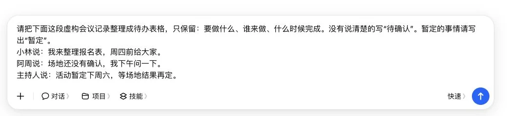

# 豆包

可以用日常语言聊天的 AI 工具，打开网页即可开始。

## 打开、登录与费用

打开[豆包网页版](https://www.doubao.com/chat/)，按页面提示登录。2026-11-16 的普通聊天练习没有付款；当前额度和价格以页面显示为准。

[跟着第一条消息练习](/start/first-message/)

<UsedIn />

## 相关评测

目前没有已发布的评测。
