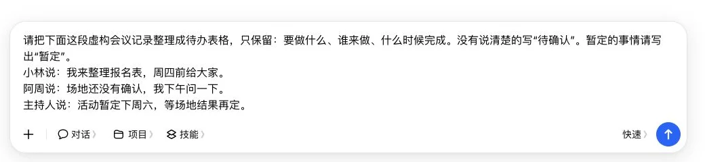
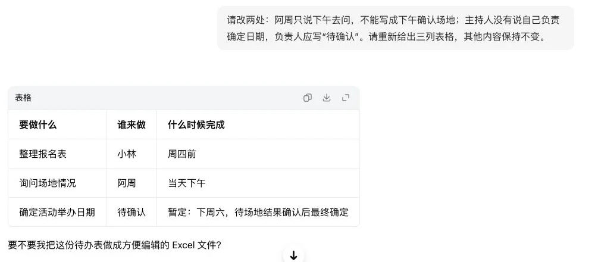

# 把会议记录变成待办表

<ArticleSummary />

先用下面这段虚构记录练习。做完后，你会得到一张可以复制进文档的待办表。

::: platform doubao

## 1. 打开豆包

打开 [豆包网页版](https://www.doubao.com/chat/)，找到页面下方的“发消息”输入框。若提示登录，按页面提示完成后再继续。

## 2. 复制这段话，粘贴并发送

点下面的“一键复制”，回到豆包，粘贴到输入框，点右下角的向上箭头发送。

<PromptBox src="meeting-to-todo" part="提示词 1" />

## 3. 看看回答有没有写错

我们试跑时，豆包给出了表格，但有两处要改：

- “下午去问场地”被写成了“下午确认场地”。问一下，不一定当天就能定下来。
- 主持人只是宣布计划，没说自己负责这件事，负责人应该写“待确认”。

遇到相同问题，把这句话接着发给它：

<PromptBox src="meeting-to-todo" part="提示词 2" />

## 做完是什么样？

这是追加上面那句话后，豆包的真实回答截图：

| 要做什么 | 谁来做 | 什么时候完成 |
| --- | --- | --- |
| 整理报名表 | 小林 | 周四前 |
| 询问场地情况 | 阿周 | 当天下午 |
| 确定活动举办日期 | 待确认 | 暂定下周六，等场地结果后再定 |

上表为方便阅读，缩短了截图中最后一格的文字。检查完人名和时间，再选中表格，复制到你的文档里。

## 换成自己的记录

把示例的三句话换成你的会议记录。先删掉电话、客户姓名等不需要的信息，再发给 AI。

本次试跑记录

2026-11-16，豆包网页版，“对话 / 快速”入口，页面随后自动使用“豆包工作”，未显示模型版本。本次未登录、没有付款；你打开时若出现登录或付费提示，以页面显示为准。

完整材料一次发送，得到第一份表格；发现两处错误后，追加一次修改要求，得到截图中的结果。没有改动截图里的回答。更早一次输入方式测试把文字分成了多条消息，未计入这次完整试跑。

“3 分钟”是练习预估，不含注册登录，也还没有经过零基础读者计时验证。

接下来可以试试：[把访谈记录变成文章初稿](/tasks/interview-to-post/)。

:::

## 检查一下

对照原记录检查人名和时间：“下午问一下”不能变成“下午确认”；没有说谁负责的写“待确认”，暂定日期要保留“暂定”。

<PlatformTestTable />
