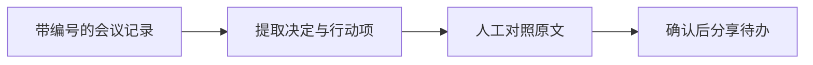

# 把会议记录整理成可执行的待办

适合会议后需要整理纪要的人。这个人工检查参与的流程不需要自动化平台；费用取决于所选 AI。

## 目标产物

一份区分“已确认”和“待确认”的清单。每条行动项都能追溯到原始记录，不自动补上责任人或截止日期。

## 准备工作

使用虚构或脱敏的会议文字。给每段加编号，例如 `[01]`、`[02]`。

## 操作步骤



### 1. 输入样例

```text
[01] 小林：我来整理报名表，周四前给大家。
[02] 阿周：场地还没有确认，我下午问一下。
[03] 主持人：活动时间暂定下周六，等场地结果再定。
```

### 2. 提取结构化清单

```text
请整理为表格：事项、责任人、截止时间、状态、原文编号。
没有明确提到的信息写“待确认”。
把临时计划与已经决定的事项分开。
不要根据经验补全日期，也不要自动通知任何人。
```

### 3. 对照原文检查

确认“下午问一下”指的是询问动作，不是确定场地；“暂定下周六”不能写成最终活动日期。

## 示例结果

下面是人工编写的验收参考，不是实测结果：

| 事项 | 责任人 | 时间 | 状态 | 来源 |
| --- | --- | --- | --- | --- |
| 整理报名表 | 小林 | 周四前，具体日期待确认 | 已认领 | 01 |
| 询问场地 | 阿周 | 当天下午，日期待确认 | 待执行 | 02 |
| 最终活动时间 | 待确认 | 待确认 | 暂定 | 03 |

## 常见问题

发言人不等于责任人。遇到“我们可以试试”之类的表达，应放入建议而非已确认待办。

## 相关推荐

[任务简报提示词包](/skills/task-brief/)
